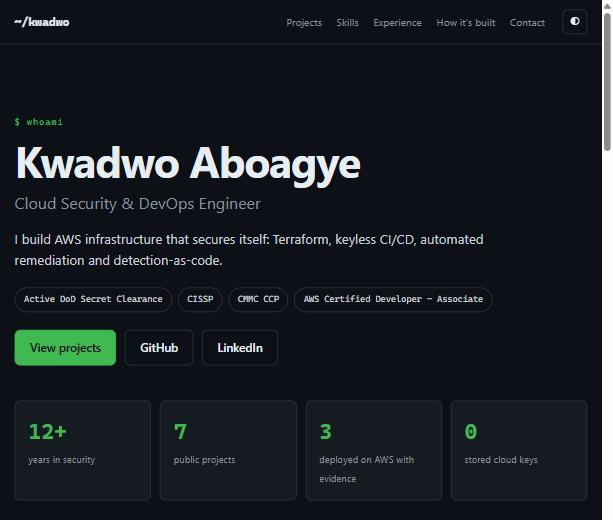
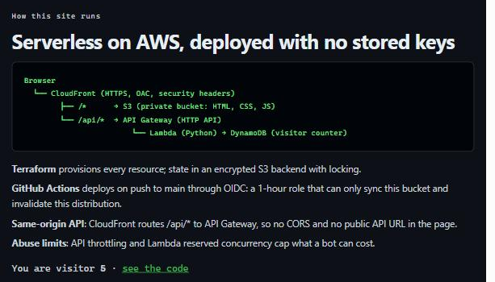
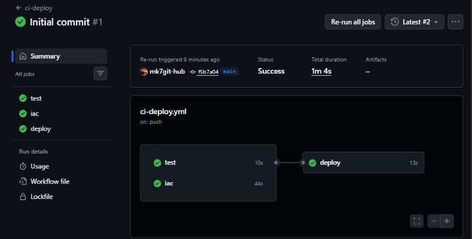

# ☁️ DevOps Cloud Portfolio: serverless on AWS, managed by HCP Terraform, no stored keys

[](https://github.com/mk7git-hub/devops-cloud-portfolio/actions/workflows/ci-deploy.yml)

**Live site:** https://doq2k1da696cu.cloudfront.net

My portfolio site, built the way I'd build a production service: a private S3 origin behind CloudFront, a live **visitor counter** (API Gateway → Lambda → DynamoDB) and **CloudWatch alarms** that email me. Delivery has two paths, both keyless:

- **Infrastructure** is planned and applied by **HCP Terraform**: a speculative plan on every pull request, and nothing applies until I approve it. HCP reaches AWS with **dynamic credentials** (OIDC), a one-hour role per run.
- **Site content** is tested, scanned and deployed by **GitHub Actions** through OIDC, with a role that can only sync this bucket and invalidate this distribution.

**There are no AWS access keys in HCP Terraform, GitHub, or this repo.**

## 📋 Table of contents

- [Architecture](#-architecture)
- [How a change ships](#-how-a-change-ships)
- [Project structure](#-project-structure)
- [Infrastructure components](#-infrastructure-components)
- [Variables and outputs](#-variables-and-outputs)
- [Security highlights](#-security-highlights)
- [Design decisions](#-design-decisions)
- [FinOps: estimated monthly cost](#-finops-estimated-monthly-cost)
- [Deploy it yourself](#-deploy-it-yourself)
- [Evidence](#-evidence)
- [What broke along the way](#-what-broke-along-the-way)
- [Tech stack](#-tech-stack)

## 🏗️ Architecture


Two paths share one CloudFront domain: `/*` serves the static site from S3, and `/api/visits` reaches the counter API. Because the API is **same-origin**, the page needs no CORS and never shows an API URL. Route 53 and ACM are written in `domain.tf` but switched off until a custom domain is set (one variable).

## 🔁 How a change ships

1. I open a **pull request**. Three checks run in parallel:
   - **HCP Terraform** posts a **speculative plan** on the PR, so I see exactly what would change in AWS.
   - GitHub Actions **test**: Ruff and pytest for the Lambda.
   - GitHub Actions **iac**: `terraform fmt`, `validate`, TFLint and Checkov on `infra/` and `bootstrap/`, with no cloud credentials.
2. I **merge to `main`**:
   - **Infrastructure**: HCP Terraform starts a run, assumes its AWS role via OIDC and plans. I review the plan and click **Confirm & apply**. Nothing applies automatically.
   - **Content**: once the checks pass, GitHub Actions swaps its OIDC token for a 1-hour session on the deploy role, **syncs `site/` to S3** (HTML cached 5 minutes, assets 1 day), **invalidates CloudFront**, then **smoke-tests** the page and `POST /api/visits`.

A text change on the site never needs an infrastructure apply, and the pipeline that ships content can't change infrastructure.

## 📁 Project structure

```
devops-cloud-portfolio/
├── bootstrap/
│   └── main.tf               # one-time: HCP OIDC trust, run role, two permissions boundaries (local state)
├── infra/                    # HCP Terraform workspace working directory
│   ├── versions.tf           # providers, HCP `cloud` block, default tags (no credentials)
│   ├── variables.tf          # inputs, incl. plan-time validation of alert_email
│   ├── site.tf               # private versioned bucket, TLS-only policy
│   ├── cdn.tf                # distribution, OAC, /api/* behavior, custom 404
│   ├── api.tf                # DynamoDB, Lambda, HTTP API, throttling, access logs
│   ├── monitoring.tf         # SNS topic + email, 5 CloudWatch alarms
│   ├── deploy_role.tf        # GitHub OIDC deploy role (sync + invalidate only)
│   ├── domain.tf             # optional ACM certificate + Route 53 alias records
│   ├── outputs.tf
│   └── terraform.tfvars.example
├── backend/visits.py         # the counter Lambda
├── tests/                    # pytest: atomic increment, read-only GET, 405, no-cache
├── site/                     # index.html, 404.html, assets/ (CSS, JS: filter, theme, counter)
├── docs/img/                 # architecture diagram and evidence screenshots
└── .github/workflows/ci-deploy.yml
```

## 🧱 Infrastructure components

### `bootstrap/main.tf`: keyless trust (run once by me)
- **IAM OIDC provider** for `app.terraform.io`, audience `aws.workload.identity`.
- **Run role** whose trust only accepts tokens for `organization:kaboagye-cloud:project:Default Project:workspace:devops-cloud-portfolio:run_phase:*`. Another workspace or organization can't use it.
- **Least-privilege policy** scoped to this project's names: S3, DynamoDB, Lambda, log groups, alarms and SNS prefixed `devops-portfolio-`, this account's CloudFront and HTTP APIs, and (only with a domain) ACM and Route 53.
- **IAM without escalation.** The workspace has to create two roles (the Lambda's and the GitHub deploy role), so the run role can create and edit roles named `devops-portfolio-*` **only if they carry the workload boundary**. That boundary caps those roles at counter reads/writes, logs, tracing and site deploys.
- **Run role boundary**: caps the role at the services above, denies any change to itself or to either boundary policy, and denies removing a boundary from any role.

### `infra/versions.tf`: core configuration
- Terraform `>= 1.6`, AWS provider `~> 5.70`, single region `us-east-1` (CloudFront needs its ACM certificates there).
- `cloud {}` block points at the HCP workspace. **No provider credentials**: HCP injects them per run when `TFC_AWS_PROVIDER_AUTH=true`. State, locking and run history live in HCP Terraform.
- Default tags on every resource: `Project`, `Owner`, `ManagedBy = hcp-terraform`.

### `infra/site.tf`: static website storage
- **Private bucket**, all four public-access blocks on, object ownership enforced (no ACLs).
- **Versioning** for rollback, old versions expired after 30 days, incomplete uploads cleaned after 7. **SSE-S3** encryption.
- **Bucket policy**: only `cloudfront.amazonaws.com` for *this* distribution (`AWS:SourceArn`) may read, and any non-TLS request is denied.

### `infra/cdn.tf`: global CDN
- **Origin Access Control** with SigV4 signing; the bucket is never public.
- **Two origins**: S3 for `/*` (AWS managed CachingOptimized policy) and the HTTP API for `/api/*` (caching disabled, all viewer headers except Host forwarded, HTTPS-only, TLS 1.2 to the origin).
- **HTTPS enforced**, IPv6, compression, `PriceClass_100` (North America and Europe edges).
- **Custom error pages**: 403 and 404 both return `404.html` with a real 404 status.
- **AWS managed SecurityHeadersPolicy** on both behaviors: HSTS, `X-Content-Type-Options`, `X-Frame-Options`, `Referrer-Policy`.

### `infra/api.tf`: visitor counter
- **DynamoDB** on-demand table with **point-in-time recovery** and encryption. It holds one number, no personal data.
- **Lambda** (Python 3.12, 128 MB, 5 s timeout, X-Ray tracing). `POST` runs an atomic `ADD visits :one`; `GET` reads; anything else returns 405. Responses are `Cache-Control: no-store`.
- **Lambda role** can only `UpdateItem`/`GetItem` on this table, write its own logs and send traces, and carries the workload boundary.
- **API Gateway HTTP API** with just two routes (`GET` and `POST /api/visits`), **throttling** (`api_rate_limit` per second, burst ×2) and JSON **access logs** kept 14 days.
- The Lambda permission only lets this API's `/api/visits` route invoke it.

### `infra/monitoring.tf`: alerting
Five alarms, all sending to SNS on **alarm and recovery** (CloudFront metrics live in `us-east-1` under `Region = Global`):

| Alarm | Metric | Threshold (5 min) | Catches |
| --- | --- | --- | --- |
| `requests-spike` | CloudFront Requests (Sum) | > 10,000 | bots, scraping, abnormal traffic |
| `5xx-rate` | CloudFront 5xxErrorRate | > 1% | origin or CloudFront errors |
| `4xx-rate` | CloudFront 4xxErrorRate | > 5% | broken links, missing pages |
| `api-5xx` | API Gateway 5xx (Sum) | > 5 | counter API failing |
| `lambda-errors` | Lambda Errors (Sum) | > 5 | counter function erroring |

`treat_missing_data = notBreaching` so a quiet site isn't reported as an outage. The SNS email address is a **sensitive** HCP variable, never in Git.

### `infra/deploy_role.tf`: keyless content deploys
- Reuses the **GitHub OIDC provider** created once by [aws-secure-landing-zone](https://github.com/mk7git-hub/aws-secure-landing-zone).
- **Trust policy** pinned to GitHub's immutable-ID subject `repo:owner@<id>/repo@<id>:ref:refs/heads/main`, audience `sts.amazonaws.com`. A renamed or recreated repo, another branch, or a pull request can't assume it.
- **Permissions**: `s3:ListBucket` on this bucket, `Put/Get/DeleteObject` on its objects, `cloudfront:CreateInvalidation` on this distribution. Nothing else. Max session 1 hour, workload boundary attached.

### `infra/domain.tf`: optional custom domain
With `domain_name` set: an **ACM certificate** for the apex and `www`, **DNS-validated** through Route 53, **alias A records** to CloudFront and **TLS 1.2 minimum** (`TLSv1.2_2021`). Empty `domain_name` = none of this is created and the CloudFront URL is used.

## ⚙️ Variables and outputs

| Variable | Default | Description |
| --- | --- | --- |
| `owner` | none | Tag value for every resource |
| `alert_email` | none, **sensitive** | Where alarms are emailed. Validated at plan time (no quotes or spaces) |
| `github_repo` | none | `owner/repo` allowed to deploy content |
| `github_owner_id` / `github_repo_id` | none | Numeric IDs for the immutable OIDC subject (from `gh api repos/OWNER/REPO`) |
| `region` | `us-east-1` | Single region for everything |
| `api_rate_limit` | `10` | Requests per second on the API (burst is double) |
| `request_spike_threshold` | `10000` | CloudFront requests per 5 minutes before the spike alarm fires |
| `reserved_concurrency` | `-1` (off) | Lambda reserved concurrency once the account limit is raised |
| `domain_name` | `""` | Optional custom domain with a Route 53 hosted zone |

| Output | Becomes repo variable | Description |
| --- | --- | --- |
| `site_url` | `SITE_URL` | Custom domain if set, else the CloudFront URL |
| `distribution_id` | `CF_DISTRIBUTION_ID` | Invalidated on each content deploy |
| `bucket` | `SITE_BUCKET` | The private origin bucket |
| `deploy_role_arn` | `AWS_DEPLOY_ROLE_ARN` | The role GitHub Actions assumes |
| `alarm_names` | none | The five CloudWatch alarms |

The four repository variables are not secrets: none of them grants access on its own.

## 🔒 Security highlights

- **No stored cloud keys anywhere**: HCP Terraform and GitHub Actions each get a 1-hour OIDC session from their own role.
- **Separation of duties**: the content pipeline can only sync one bucket and invalidate one distribution; infrastructure changes need a reviewed plan and my approval in HCP Terraform.
- **IAM without privilege escalation**: every role the workspace creates must carry the workload boundary, and the run role can't edit itself, either boundary, or remove one.
- **Private origin**: S3 is never public; only this distribution can read it (OAC + `AWS:SourceArn`), and non-TLS access is denied.
- **Least-privilege Lambda**: two DynamoDB actions on one table, plus its own logs and traces.
- **Abuse limits and alerting**: API throttling, optional reserved concurrency, and five alarms that email me on alarm and recovery.
- **Security headers** on every response, site and API.
- **Secrets stay secret**: the alert email is a sensitive HCP variable, never committed or shown.
- **Scanned in CI**: Checkov infra 65 passed / 0 failed (25 documented exceptions), bootstrap 21 / 0 (12). Each exception is a `#checkov:skip` with its reason in the code, mostly cost decisions for a public site.

## 🧭 Design decisions

| Decision | Why | Trade-off |
| --- | --- | --- |
| HCP Terraform for infrastructure, GitHub Actions for content | Infra gets plans on PRs, approval before apply and remote state; content ships in a minute without an apply | Two systems to understand instead of one |
| Dynamic credentials over access keys | Nothing long-lived to leak or rotate | One-time bootstrap of the OIDC trust |
| Permissions boundaries instead of no IAM | The workspace must create the Lambda and deploy roles; boundaries make that safe | More policy to reason about (documented in `bootstrap/`) |
| API behind CloudFront at `/api/*` | Same origin as the site: no CORS, no API URL in the page, one TLS endpoint | API Gateway's own URL is still reachable; throttling and Lambda limits bound abuse |
| Atomic `ADD` in DynamoDB | Two visitors at once never lose a count; no read-then-write race | None |
| OIDC subject with numeric IDs | A renamed or recreated repo can't inherit the deploy role | Needs the owner and repo IDs as variables |
| HTML cached 5 min, assets 1 day | New deploys show up fast while assets stay cheap | Invalidation on every deploy (first 1,000 paths/month free) |
| Reserved concurrency off by default | New accounts have a limit of 10 and AWS keeps 10 unreserved, so reserving fails | Turn it on once the limit is raised |
| No WAF, no CloudFront access logs | Each would cost more than the whole site | Throttling and alarms instead; documented as Checkov exceptions |

## 💰 FinOps: estimated monthly cost

| Service | Cost |
| --- | --- |
| S3 (storage + requests) | ~$0.01 |
| CloudFront | always-free tier (10M requests, 1 TB) covers a portfolio; ~$1 per extra 1M HTTPS requests |
| API Gateway HTTP API | ~$1 per 1M requests (free tier in the first 12 months) |
| Lambda | always-free tier (1M requests, 400,000 GB-s) |
| DynamoDB on-demand + PITR | cents for one small item |
| CloudWatch (5 alarms, 14-day logs) | ~$0.50 |
| SNS (email) | free |
| HCP Terraform | free tier |
| ACM certificate | free |
| Route 53 hosted zone (only with a domain) | ~$0.50 |
| **Total** | **about $0.50–1 / month** (~$1.50 with a domain) |

A destroy run in HCP Terraform removes everything.

## 🚀 Deploy it yourself

Prerequisites: the GitHub OIDC provider from [aws-secure-landing-zone](https://github.com/mk7git-hub/aws-secure-landing-zone), an HCP Terraform organization connected to GitHub, AWS CLI signed in.

1. **Bootstrap (once, locally):** `cd bootstrap`, set `hcp_organization` in `terraform.tfvars`, then `terraform init && terraform apply`. If the account already has an `app.terraform.io` OIDC provider, import it first:
   ```bash
   terraform import aws_iam_openid_connect_provider.hcp \
     arn:aws:iam::$(aws sts get-caller-identity --query Account --output text):oidc-provider/app.terraform.io
   ```
   Note the `hcp_run_role_arn` output.
2. **HCP Terraform:** a **VCS-driven** workspace `devops-cloud-portfolio` on this repo, working directory `infra`, **manual apply**.
3. **Workspace variables:**
   - env `TFC_AWS_PROVIDER_AUTH = true`
   - env `TFC_AWS_RUN_ROLE_ARN = <hcp_run_role_arn>`
   - Terraform `owner`, `github_repo`, `github_owner_id`, `github_repo_id`
   - Terraform `alert_email` (**sensitive**, bare address, HCL off)
4. **New run → Confirm & apply**, then confirm the SNS subscription email.
5. Set the four repository **variables** from the run's outputs (Settings → Secrets and variables → Actions → Variables): `AWS_DEPLOY_ROLE_ARN`, `SITE_BUCKET`, `CF_DISTRIBUTION_ID`, `SITE_URL`. Every push to `main` now tests, scans and deploys content.

## 📸 Evidence

Live in a dedicated AWS account.

**The site**, served from a private S3 bucket through CloudFront:



**The visitor counter working end to end** (browser → CloudFront `/api/*` → API Gateway → Lambda → DynamoDB):



**Pipeline:** tests and IaC checks gate the deploy; the deploy job signs in through OIDC, syncs the bucket, invalidates CloudFront and smoke-tests the page and the API:



## 🧯 What broke along the way

| Symptom | Cause | Fix |
| --- | --- | --- |
| First pipeline run: deploy failed with "Could not load credentials" | The deploy ran before the OIDC role and the repo variables existed | Applied the infrastructure, set the four repo variables, re-ran the same commit: green, no code change. The deploy job now skips itself until `AWS_DEPLOY_ROLE_ARN` is set |
| An earlier HCP Terraform build created 20 of 21 resources, then `SNS Subscribe ... InvalidParameter: Email address` | The sensitive `alert_email` held a malformed value, and sensitive values can only be replaced, not viewed | Replaced it and re-ran. A `validation` block now fails a bad address at **plan** time, before anything is created |

## 🛠️ Tech stack


## 🙏 Credits

Pattern inspired by the [Cloud Resume Challenge](https://cloudresumechallenge.dev/) by Forrest Brazeal; README structure and FinOps framing inspired by [allaouiyounespro/HCP_Portfolio](https://github.com/allaouiyounespro/HCP_Portfolio). Architecture, code and diagram are my own.
